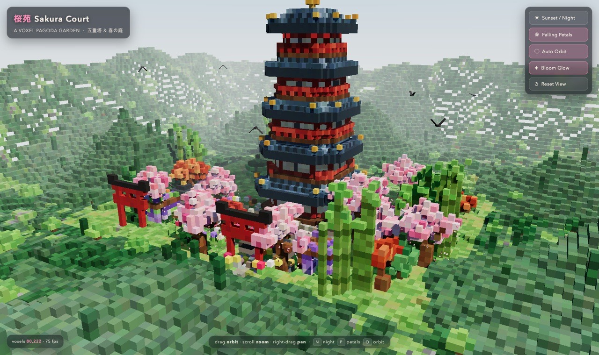
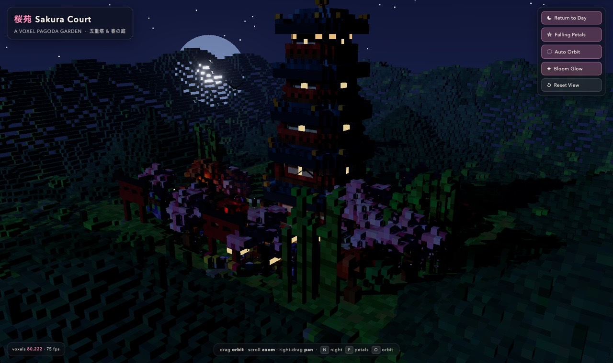

# 桜苑 · Sakura Court — Voxel Pagoda Garden

A single-file, interactive **voxel-art scene** of a Japanese pagoda garden, built with [three.js](https://threejs.org/) and rendered entirely from voxels (Minecraft-style cubes).

**▶ Live demo: <https://obiwan007.github.io/voxel-pagoda-garden/>**

[](https://obiwan007.github.io/voxel-pagoda-garden/)
[](https://obiwan007.github.io/voxel-pagoda-garden/)

*Click a screenshot to open the live demo.*

---

## What's in the scene

- **Five-tier pagoda** — red lacquer tiers, dark tiled roofs, upturned gold eave tips, a full gold *sōrin* finial, and windows that light up warmly at night
- **Cherry blossoms everywhere** — hand-placed sakura trees, a blossom-ringed pond, ~430 falling petals, petal drift on the ground
- **Koi pond** — rippling water, five circling koi, an arched moon bridge, reeds, lily pads, a heron, and a small boat
- **Garden architecture** — two torii gates, stone tōrō lanterns, wisteria pergolas, a hokora shrine, a raked gravel court with stepping-stone walks
- **Vegetation** — pines, maples, a deep-green bamboo grove, shrubs, flower beds, rocks
- **Living surroundings** — rolling hills, a distant speckle forest that fades into haze, drifting voxel clouds, circling birds
- **Day ↔ sunset/night cycle** — dusk palette in between, fireflies, 1,050 stars, and the moon rising over the western ridge

~**80,000 voxels**, rendered as a few InstancedMeshes at 75 fps (vsync-capped).

## Controls

| Input | Action |
| --- | --- |
| Drag | Orbit the camera |
| Scroll | Zoom |
| Right-drag | Pan |
| **N** / button | Sunset / night toggle |
| **P** / button | Falling petals on/off |
| **O** / button | Auto orbit on/off |
| **B** / button | Bloom glow on/off |
| Reset View | Return to the intro camera |

A short camera glide introduces the scene on load; the first drag takes over the camera.

## Running it

The whole scene is one HTML file with no build step — three.js is pulled from a CDN, so an internet connection is required.

- **Easiest:** open `voxel-pagoda-garden.html` in Chrome (double-click, or drag it into a tab).
- **Local server (optional):**
  ```sh
  python3 -m http.server 8000
  # then open http://localhost:8000/voxel-pagoda-garden.html
  ```

Works on GitHub Pages at the repository root (`index.html` redirects to the scene).

## The initial prompt

This project was built from the following prompt, verbatim:

> Design and create a very creative, elaborate and detailed voxel art scene
> of a pagoda in a beautiful garden with trees, include some cherry blossoms. Make the scene impressive and varied and use colorful voxels. Use whatever libraries to get this done but make sure I can paste it all into a single HTML file and open it in chrome.
> Use playwright mcp to test the page.

## How it's made

- Deterministic generation: a seeded `mulberry32` RNG plus value-noise/fbm terrain, so the same garden is rebuilt on every load
- All voxels live in maps and are merged into a handful of `InstancedMesh`es (hidden-voxel culling included), with baked "aerial perspective" replacing heavy fog for the far forest
- Day/night is a single `nightF` value that lerps sky, lighting, glow colors, water tint, stars and bloom strength
- UnrealBloom post-processing is imported dynamically inside `try/catch`, so the page still works if the CDN's postprocessing modules are unavailable
